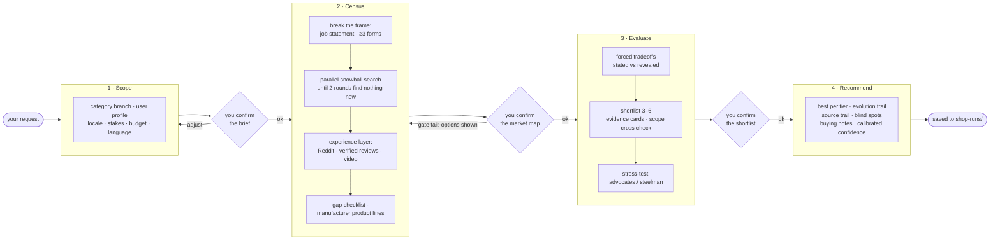
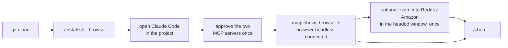

# shop — a purchase-decision skill for Claude Code

**Finds YOUR best product, not THE best product.**

`/shop <thing you want to buy>` turns Claude Code into a research partner that maps the
whole market before it forms an opinion, asks you forced tradeoffs instead of guessing
your priorities, verifies every claim against a source, and tells you what it could not
check. Four steps, and you approve each one before the next starts.

```
/shop a standing-desk walking pad
/shop running shoes for a heavy runner --light
```

## The flow



Every diamond is a real stop: the skill renders its evidence in the message, ends its
turn, and asks for your decision on the next one. It never buys anything.

## Why this exists

Ask any assistant "what's the best X" and you get the first page of SEO results
rephrased with confidence. Three things go wrong, every time:

1. **Tunnel vision from sentence one.** "Best walking pad" never surfaces the folding
   treadmill, the used commercial unit, or the under-desk stepper that would have done the
   job better. The category word in your question becomes the ceiling of the search.
2. **Stale, marketing-shaped memory.** A model's product knowledge is a snapshot of
   whatever was most written about. It will name a discontinued model, quote a manufacturer
   efficiency figure as if it were a lab result, and never mention the regulator stop-use
   notice from last spring.
3. **Missing uncertainty.** The assistant reports what it found and nothing about what it
   could not reach. "No complaints found" and "I could not read the complaints" look
   identical in the answer.

This skill is the result of fourteen revisions against real purchases. Every rule in it was
added because a run went wrong without it.

## Quick start

```bash
git clone https://github.com/doriru89/shop-skill.git
```

```bash
./shop-skill/install.sh --browser
```

Then open Claude Code in the same folder, approve the two MCP servers when it asks, and
type `/shop` followed by what you want to buy. Skip `--browser` if you only want the skill
and no browser automation; see the levels below.

## Three install levels

The skill runs on Claude Code's built-in web tools alone. A browser lets it read the pages
that matter most. Whatever you install, the run's coverage table tells you which channels
were actually reached, so a lower level shows up as an honest gap, not a silent one.

| Level | You install | The census can read directly | Still out of reach |
|---|---|---|---|
| **L0** | `./install.sh` | search results and pages WebFetch can open | Reddit thread bodies, Amazon review text, bot-protected storefronts → tagged `[UNVERIFIED]`, listed as blind spots |
| **L1** | `./install.sh --browser` (two Playwright MCP servers) | manufacturer product listings, public Reddit threads, YouTube pages, review sites | Amazon verified-purchase review text (login-walled) |
| **L2** | sign in once in the headed browser window | everything, including Amazon reviews and logged-in Reddit | sites that block automation outright |



Full details, verification steps, an optional stealth browser, and uninstall are in
[`setup/SETUP.md`](setup/SETUP.md). What the installer writes:

| File | Purpose |
|---|---|
| `.claude/skills/shop/` | the skill: router, four step files, browser playbook |
| `.mcp.json` | `browser` (headed, persistent profile in `~/.shop-skill/`) and `browser-headless` (isolated); from [`setup/mcp.json`](setup/mcp.json) |
| `.claude/settings.local.json` | permission rules so search, fetch, browser and `curl -I` calls do not prompt every time; from [`setup/settings.json`](setup/settings.json) |

Existing files are never overwritten; the installer prints what to merge instead. The
browser profile holds your cookies and lives in your home folder, outside any repository.

## Usage

| Command | Effect |
|---|---|
| `/shop <request>` | Full run, four steps with a gate after each |
| `/shop <request> --light` | Reduced gates (≥5 brands, ≥10 products); still a source trail and blind spots |
| `/shop <request> --skip-education` | Reuse a saved run for the same category: skip census, re-ask one or two tradeoffs, go straight to evaluate |
| `/shop evaluate` | Enter at a later step when the earlier output already exists in the conversation or in `shop-runs/` |

Write in whatever language you like. The skill detects it at scope and answers in it all
the way through.

Runs are written to `shop-runs/` at the project root: one Markdown file per purchase plus a
`brand-cache.yaml` that carries brand research across categories. Add the folder to
`.gitignore` if your purchases are private.

A full run takes a while: expect ten to twenty minutes of wall-clock time and several
checkpoints on a high-stakes purchase. That is the point. For a $15 decision, say
`--light` or do not use the skill.

## Worked examples and a live demo

Two synthetic runs show what a saved run looks like at every gate: the confirmed job
statement, the forms enumerated, the coverage table with channels honestly marked PARTIAL,
the tradeoff log with a stated-versus-revealed preference, the filtered-out list, the
steelman, a per-tier decision with confidence calibrated per claim, and the blind-spot
section. The shape is real, the numbers are placeholders.

- [`examples/travel-charger.md`](examples/travel-charger.md): a GaN travel charger.
- [`examples/christmas-string-lights.md`](examples/christmas-string-lights.md): outdoor
  Christmas lights for a two-storey house in a cold climate.

[`demo/shop-workflow.html`](demo/shop-workflow.html) replays the Christmas-lights run as an
interactive page built around a map of the market (price against ladder time per year).
Every product is a point; each decision you make dims what is ruled out and shrinks the
box around what is left, until the sweet spot is literally a point on the map. Click any
point for its card. Flip the "thin census" switch to see a gate fail and the recommendation
downgrade itself to a preliminary read, and press "Are you sure?" to see a challenge
answered with evidence instead of a flipped pick. Sources and blind spots stay at the
bottom. The demo is a condensed view: a real run's messages carry the full tables that the
page folds under "Show the full evidence". Open the file in a browser, or use the hosted
copy: https://claude.ai/artifact/RWmGQd9uTNnnKES9WhYnMd

## What each step does

| Step | What happens | What you see before approving |
|---|---|---|
| **Scope** | Lock what is being bought and who is buying it: category branch, user profile, locale, stakes, budget, your language. No search yet. | The complete brief as a field list, including the stakes arithmetic |
| **Census** | Break the frame (job statement without the category noun, ≥3 alternative forms), then a parallel snowball search until two rounds find nothing new. Reddit, verified-purchase reviews and video are read directly, not through search snippets. Product lines come from manufacturer pages, not memory. A gap checklist and a seven-row source-coverage table close the step. | A conversational market map: brand landscape, price tiers, technology routes, what each tier buys you |
| **Evaluate** | Binary tradeoffs tuned to your use case reveal what you actually value (and where it differs from what you said). The shortlist gets evidence cards with a source per claim, a scope cross-check, and a stress test: one advocate agent per product on high-stakes runs, one steelman of a rejected alternative on light ones. | Priorities with the answer that revealed each, the shortlist, and the filtered-out list with reasons |
| **Recommend** | Best in each price tier, the evolution trail from your first wording to the final pick, a validated source trail, a mandatory blind-spot section, buying notes, and confidence language calibrated to coverage. | The recommendation itself |

**Gates are mechanical.** Between steps the router checks counts, not vibes: brands ≥8
and products ≥20 on a full run, every gap-checklist row addressed, ≥2 independent sources per
shortlisted product, ≥1 steelman, ≥2 named blind spots. A failed gate is shown to you with
options; the skill never proceeds silently, and a run below the census gate is not allowed
to say "recommended", only "preliminary read".

## Principles the skill is built on

- **Market before opinion.** No product may appear in a recommending position until the
  census gate passes. Brand names earlier are market intelligence, not advice.
- **Experience over specs.** Real owner reports outrank spec sheets. The census has a
  separate, mandatory phase for the platforms where those reports live, because search
  engines return the editorial layer and almost nothing else.
- **Explore, don't query.** Each source seeds the next search. Query templates were tried
  and removed; outcome gates ("two rounds with nothing new", "entities span ≥2 forms") work
  better than prescribed queries.
- **Informed means knowing the downsides.** Every card carries weaknesses; every
  recommendation carries a blind-spot section derived from what the census could not reach.
- **Flipping on the first challenge is zero conviction.** If you push back, the skill
  searches two more sources on the disputed point and shows you evidence for both sides. It
  does not change its answer to please you.
- **The human decides.** The AI proposes, renders its evidence in the message body, ends
  its turn, and asks for the decision on the next one.

## Repository layout

```
skills/shop/
  SKILL.md                  router: soul, routing table, invariants, gates, flags
  references/scope.md       step 1 — lock the brief
  references/census.md      step 2 — break the frame, map the market
  references/evaluate.md    step 3 — tradeoffs, evidence cards, stress test
  references/recommend.md   step 4 — per-tier pick, source trail, blind spots, save
  references/browser.md     helper — which browser for which page, reading without flooding context
setup/
  mcp.json                  two Playwright MCP servers (browser, browser-headless)
  settings.json             permission rules to copy into .claude/settings.local.json
  SETUP.md                  the three levels in detail, verification, optional stealth browser
examples/                   two synthetic worked examples
demo/shop-workflow.html     interactive replay of one run (no build step, no dependencies)
install.sh                  copies the skill; --browser also writes .mcp.json and the rules
```

The router is deliberately thin. It owns the gates and the human-in-the-loop contract;
each step file owns one procedure and declares the only tools it may use. A step is read
into context only when the router reaches it, so the model is never holding the
recommendation rules while it is still supposed to be mapping the market.

## Design notes

Things that were learned the hard way and are now rules:

- **Advisory principles do not survive contact with a model.** Version 4 compressed 36
  recorded failure modes into four principles and six gates, all phrased as guidance. The
  model understood every one of them and skipped them when convenient. Version 5 turned
  each into a countable gate with a named check, and the router verifies between steps.
- **Query templates make search worse.** Fixed query patterns produced long, over-specific
  queries that returned SEO pages. Short queries (≤3 words), ≥5 angles per round, and a
  convergence gate replaced them.
- **Search snippets of Reddit are not Reddit.** Marking a channel "covered" because a
  Reddit link appeared in a search result is the single most common way a run reports more
  coverage than it has. "Covered" requires direct platform access; a login wall means
  "partial", with the reason written down.
- **Convergence is not coverage.** A snowball can converge cleanly inside the wrong
  category. New entities are tagged with their form, and two rounds that only produce the
  original form send the census back to the frame break.
- **Numbers without test conditions are not evidence.** An efficiency percentage from a
  manufacturer page and one from an instrumented review are not the same number. Each claim
  carries a provenance tag, and tables that mix them carry a warning.
- **The user cannot see tool output.** In most Claude Code surfaces tool results are
  collapsed. Every checkpoint is two turns: evidence rendered in the message body and the
  turn ended, then the decision asked on the next turn with nothing but the options.
- **One alarming article beats a hundred good experiences unless you look for the other
  side.** Safety claims trigger a counter-search for the opposite claim, a check for
  retraction, and a count of actual incident reports rather than reposts.

## Limitations

- It is slow by design. A full run makes dozens of searches and several checkpoints.
- It depends on what the web tools can reach. Login walls, bot blocks and regional
  storefronts reduce coverage; the skill reports that rather than hiding it, but the
  recommendation is only as good as the reachable evidence.
- Price and availability are read live and go stale immediately. Check before you buy.
- It is a Claude Code skill. The procedure would port to other agent frameworks, but the
  tool names and the `AskUserQuestion` gate pattern are Claude Code's.
- Automated reading of a site may be against that site's terms. The browser setup reads
  pages the way you would, at human pace, and stops at a block; you decide where to use it.

## Third-party software

This repository contains no third-party code. The browser setup references these packages
by name; they are downloaded by `npx` on first use under their own licenses:

| Package | What it is | License |
|---|---|---|
| [`@playwright/mcp`](https://github.com/microsoft/playwright-mcp) | Microsoft's Playwright MCP server, the default browser in `setup/mcp.json` | Apache-2.0 |
| [`patchright-mcp`](https://github.com/Kaliiiiiiiiii-Vinyzu/patchright-mcp) | a community fork of the above using the Patchright patched Chromium, mentioned as an optional stealth alternative in `setup/SETUP.md` | Apache-2.0 |

Neither project is affiliated with this one.

## Attribution

- Jobs-to-be-done three-tier competition: Clayton Christensen (HBS, 2003)
- PRESS search-strategy checklist: McGowan et al., *Journal of Clinical Epidemiology* 75 (2016)
- Non-customer tiers: Kim & Mauborgne, *Blue Ocean Strategy*

## Author

Austin Wang — [portfolio](https://doriru89.github.io/az-portfolio/). Extracted from a
personal AI operating system where it ran against real purchases from June to September
2026; the private runs are not included here.

MIT licensed.
